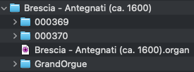

# BresciaODFforGrandOrgue

Brescia ODF for GrandOrgue

## Overview

Sonus Paradisi offers a [sample set for Hauptwerk](https://www.sonusparadisi.cz/en/organs/italy/brescia-st-carlo.html) of the organ of St. Carlo, Brescia. Note the set is a rather early set, released in 2007.

In this repository you'll find an organ definition file (ODF) and additional files so you can use the sample set with [Grand Orgue](https://github.com/GrandOrgue/grandorgue). It has initially been derived from the Hauptwerk ODF by using [OdfEdit](https://github.com/GrandOrgue/OdfEdit). I did only minor adjustments (fixing detuned pipe samples, added a facade panel).

## Installation

* Purchase the sample set for Hauptwerk and install it either using Hauptwerk or extract the archives manually (you'll need the two folders 000369 and 000370).

* [Download](https://github.com/GrandOrgue/grandorgue/releases) and install GrandOrgue.

* Download the zip file and extract it.

* Put all the extracted files in one place. The required structure is as follows:
  
  

* Ensure your MIDI keyboard is connected to your computer.

* Start GrandOrgue

* Press the key »O« and select the file »Brescia - Antegnati (ca. 1600).organ«. The sample set will be loaded.

* From the menu »Window« choose »Zoom« so as to ensure the main panel fills the whole screen (you may want to repeat this step for any further panels you open).

* Right click (or hold the Ctrl key and klick) on the keybed respectively pedalboard. Klick the button »Wait for Event«, then press a key on your key- respectively pedalboard, then confirm the dialog.

* Optionally open further panels (e.g. Facade).

* From the menu »File« choose »Save« so that the assignment and the chosen panels are still present after the next start.

* Enjoy :) .
